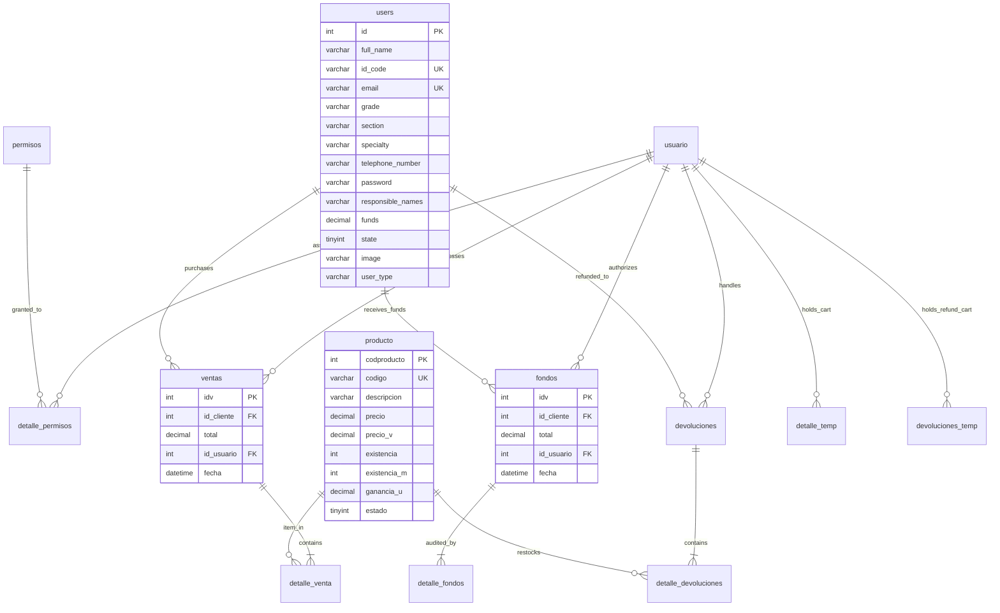

# WalletID Platform - Campus Digital Wallet & Cashless POS System


**WalletID** is a full-featured campus digital wallet and Point of Sale (POS) ecosystem engineered for schools, universities, and corporate campuses. Built with **PHP 8**, **MySQL / MariaDB**, **SB Admin**, and **Skydash**, the platform eliminates cash handling across cafeteria lines, bookstore counters, and campus stores through digital student ID cards, instant top-ups, barcode-assisted checkouts, and self-service balance tracking.

---

## 📋 Table of Contents

- [Overview](#-overview)
- [System Architecture](#-system-architecture)
- [Core Features](#-core-features)
- [Database Entity-Relationship Schema](#-database-entity-relationship-schema)
- [Default Demo Credentials](#-default-demo-credentials)
- [Installation & Setup (XAMPP / Apache)](#-installation--setup-xampp--apache)
- [Environment Configuration](#-environment-configuration)
- [Repository Structure](#-repository-structure)
- [License](#-license)

---

## 🌟 Overview

| Element | Description |
|---|---|
| **Situation** | Educational institutions and closed campuses experience severe bottlenecks during peak cafeteria lunch periods due to cash transactions, lost or stolen physical money, and lack of transparency for parents and students regarding daily meal expenditures and remaining funds. Traditional POS tools lack integrated cardholder self-service portals and suffer from tight coupling with hardcoded institutional parameters. |
| **Task** | Engineer a unified, secure, dual-portal digital wallet ecosystem capable of processing sub-second barcode student ID checkouts, real-time balance deductions, immediate cashier-assisted top-ups, refund handling, itemized thermal receipt generation, and a dedicated mobile-responsive self-service cardholder portal with complete transaction audit trails. |
| **Action** | Architected the **WalletID Platform** with a decoupled dual-portal hierarchy (`admin/` POS and `portal/` cardholder self-service). Implemented salted BCrypt password security (`PASSWORD_BCRYPT`), an 11-permission Role-Based Access Control (RBAC) engine, thermal ticket generation with Code128 barcodes via FPDF, and an environment-aware database abstraction layer (`config.example.php`). Sanitized all hardcoded institutional dependencies into neutral, production-ready white-label branding. |
| **Result** | Cashless checkout by student ID, cashier-assisted top-ups and refunds, and a self-service portal where cardholders review balances and purchase history. All queries that receive external input use parameterized mysqli prepared statements (`lib/safe_query.php`). |

---

## 🏗️ System Architecture

WalletID is organized as a decoupled, multi-tier web application serving two distinct user roles:

```
                          ┌──────────────────────────────────────┐
                          │         WalletID Platform Root       │
                          │        (config.php / Database)       │
                          └──────────────────┬───────────────────┘
                                             │
                   ┌─────────────────────────┴─────────────────────────┐
                   ▼                                                   ▼
       ┌───────────────────────┐                           ┌───────────────────────┐
       │     admin/ (POS)      │                           │   portal/ (Student)   │
       │  Cashier & Management │                           │ Cardholder Self-Serve │
       ├───────────────────────┤                           ├───────────────────────┤
       │ • Cashless Barcode POS│                           │ • Real-time Balance   │
       │ • Balance Top-ups     │                           │ • Purchase History    │
       │ • Inventory & Stock   │                           │ • Recharge Ledgers    │
       │ • Returns & Refunds   │                           │ • Account Credentials │
       │ • RBAC User Control   │                           │ • Mobile Responsive   │
       │ • Thermal Receipts    │                           │                       │
       └───────────────────────┘                           └───────────────────────┘
```

### 1. Cashier & Admin POS Terminal (`admin/`)
- Powered by SB Admin with Bootstrap and DataTables.
- Provides high-speed cashier barcode scanning for student IDs and products.
- Enforces atomic fund validation: checkouts are blocked if student balance is insufficient.
- Generates 80mm printable thermal sales receipts and recharge tickets with Code128 barcodes.

### 2. Cardholder Self-Service Portal (`portal/`)
- Powered by a clean, mobile-first Skydash interface.
- Allows students, faculty, and cardholders to inspect available balance in real time.
- Displays comprehensive purchase histories with item descriptions, unit prices, timestamps, and recharge records.

### 3. Decoupled Data Access Layer
- Database connectivity in both `admin/conexion.php` and `portal/conexion.php` checks for a root `config.php`, local `config.php`, or environment variable overrides before falling back to defaults.
- Prevents database credential leakage and enables seamless deployment across local XAMPP, staging, or containerized environments.

---

## ⚡ Core Features

### 1. Cashless POS Checkout
- **Instant Student ID Lookup**: Cashiers type or scan a student ID code (`id_code`) to instantly load cardholder photo, name, grade, and current balance.
- **Stock & Balance Verification**: Prevents overdrawing student funds or ordering out-of-stock items.
- **Barcode Printing**: Thermal ticket generation using FPDF with printable barcodes for audit trails.

### 2. Cashier Balance Top-Ups (`admin/src/fondos.php`)
- **Quick-denom Buttons**: Cashiers can quickly top-up card balances using one-click increments ($0.25, $1.00, $5.00, $10.00) or custom amounts.
- **Instant Credit**: Recharge updates the cardholder's available balance in real time and logs an audited entry with transaction receipt.

### 3. Cafeteria & Store Inventory Control
- Complete CRUD management for campus products and food items.
- Configurable minimum stock warning thresholds (`existencia_m`) and unit profit margin tracking (`ganancia_u`).
- Real-time stock decrement upon sale and automatic stock restoration upon refund.

### 4. Returns & Refund Management (`admin/src/nuevas_devoluciones.php`)
- Reverses erroneous transactions, restocks returned items, and credits the refund amount directly back to the student's digital wallet.

### 5. Granular Role-Based Access Control (RBAC)
Eleven granular permission flags allow configuring cashiers, warehouse clerks, and financial administrators:
- `Pagina Principal` (Dashboard analytics)
- `Administradores` (Admin account CRUD)
- `Comunidad Educativa` (Cardholder registry)
- `Productos` (Catalog management)
- `Realizar Venta` (POS cashier terminal)
- `Registro Venta` (Sales transaction ledger)
- `Agregar Saldo` (Fund top-up desk)
- `Registro Abonos` (Recharge logs)
- `Realizar Devolucion` (Refund processing)
- `Registro Devoluciones` (Return ledger)
- `Informacion Ticket` (Store receipt details)

---

## 🗄️ Database Entity-Relationship Schema

The database consists of 14 normalized tables under the `wallet_id` schema:



---

## 🔑 Default Demo Credentials

The included demo seeds (`database/seeds.sql`) provide pre-configured administrative and student cardholder accounts:

### 1. Administrative / Cashier POS Portal (`/admin/`)
| Field | Value | Notes |
|---|---|---|
| **URL** | `http://localhost/wallet-id-platform/admin/` | Admin & POS Terminal |
| **Username** | `admin` | Primary Owner account |
| **Password** | `admin` | Authenticated via BCrypt |
| **Permissions** | All 11 Permissions | Full administrative control |

### 2. Cardholder Self-Service Portal (`/portal/`)
| Field | Cardholder 1 | Cardholder 2 |
|---|---|---|
| **URL** | `http://localhost/wallet-id-platform/portal/` | `http://localhost/wallet-id-platform/portal/` |
| **Email** | `cardholder1@walletid.local` | `cardholder2@walletid.local` |
| **Password** | `password123` | `password123` |
| **Student ID Code** | `ID-2026-001` | `ID-2026-002` |
| **Cardholder Name** | Alex Rivera | Sofia Gomez |
| **Available Funds** | **$25.00** | **$15.50** |
| **Specialty / Grade** | Software Engineering (12th) | Electronics & Robotics (11th) |

---

## 🚀 Installation & Setup (XAMPP / Apache)

### Prerequisites
- PHP 8.0 or higher (`php-mysqli`, `php-mbstring`, `php-gd` extensions enabled)
- MySQL 5.7+ or MariaDB 10.3+
- Web server: Apache (XAMPP / LAMP) or Nginx

### 1. Place Repository in Web Root
```bash
# Clone or copy into your Apache htdocs directory:
cp -r wallet-id-platform C:/xampp/htdocs/wallet-id-platform
```

### 2. Initialize Database & Seed Data
Execute the schema and seeds via MySQL CLI or phpMyAdmin:
```bash
# Using MySQL Command Line
mysql -u root -p < database/schema.sql
mysql -u root -p < database/seeds.sql
```

### 3. Create Configuration File
Copy `config.example.php` to `config.php`:
```bash
cp config.example.php config.php
```
Adjust credentials in `config.php` if your MySQL installation has a custom user or password.

### 4. Launch Application
- **Admin POS Terminal**: [http://localhost/wallet-id-platform/admin/](http://localhost/wallet-id-platform/admin/)
- **Student Portal**: [http://localhost/wallet-id-platform/portal/](http://localhost/wallet-id-platform/portal/)

---

## ⚙️ Environment Configuration

Configuration is loaded from root `config.php` or environment variables:

| Constant | Env Variable | Default | Description |
|---|---|---|---|
| `DB_HOST` | `DB_HOST` | `localhost` | MySQL Server Hostname or IP |
| `DB_PORT` | `DB_PORT` | `3306` | MySQL Port |
| `DB_USER` | `DB_USER` | `root` | Database Username |
| `DB_PASS` | `DB_PASS` | `""` | Database Password |
| `DB_NAME` | `DB_NAME` | `wallet_id` | Database Schema Name |
| `DB_CHARSET` | `DB_CHARSET` | `utf8mb4` | Connection Character Encoding |
| `APP_NAME` | `APP_NAME` | `WalletID - Campus Digital Wallet` | Application Title |
| `APP_SALT` | `APP_SALT` | `HelloKitty` | Password Hash Salt |

---

## 📁 Repository Structure

```
wallet-id-platform/
├── .gitignore             # Standardized git exclusions for config and temp files
├── LICENSE                # MIT License
├── README.md              # Comprehensive technical documentation & setup guide
├── config.example.php     # Global configuration template
│
├── database/
│   ├── schema.sql         # 14 normalized relational tables (MySQL/MariaDB)
│   └── seeds.sql          # Seed data (Admin, 2 Cardholders, Products, Recharges)
│
├── admin/                 # Cashier POS, inventory, user control & recharge system
│   ├── index.php          # Admin authentication gateway
│   ├── conexion.php       # Decoupled database connector
│   ├── error_500.html     # Graceful error page
│   ├── assets/            # CSS, JavaScript, icons and WalletID branding assets
│   │   ├── css/
│   │   ├── js/
│   │   └── img/           # Clean WalletID SVGs and logos
│   └── src/               # POS views, controllers, report engines and PDF tickets
│       ├── index.php      # Financial dashboard
│       ├── ventas.php     # High-speed POS checkout terminal
│       ├── fondos.php     # Student ID balance top-up counter
│       ├── productos.php  # Inventory catalog & threshold alerts
│       ├── clientes.php   # Student/cardholder management
│       ├── usuarios.php   # Cashier & administrator RBAC
│       ├── includes/      # Reusable header, navigation and footer components
│       └── pdf/           # FPDF thermal ticket and receipt generation
│
└── portal/                # Cardholder self-service web application
    ├── login.php          # Student / Cardholder authentication
    ├── logout.php         # Secure session destruction
    ├── dashboard.php      # Live balance overview & card code display
    ├── compras.php        # Itemized purchase history ledger
    ├── fondos.php         # Recharge & credit audit ledger
    ├── navbar.php         # Responsive top navigation & brand header
    ├── footer.php         # Responsive portal footer
    ├── conexion.php       # Decoupled database connector
    ├── css/               # Skydash styling stylesheets
    ├── images/            # Portal branding & SVG assets
    ├── js/                # Interactive UI scripts & DataTables logic
    └── vendors/           # Vendor asset bundle (Feather, Themify, DataTables)
```

---

## 📄 License

This project is licensed under the [MIT License](LICENSE) - see the [LICENSE](LICENSE) file for details.
